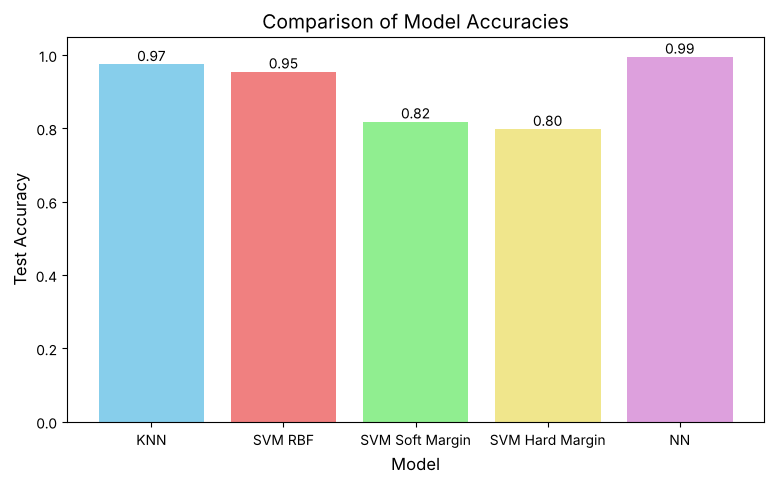
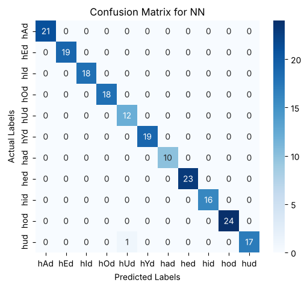

# Vowel Recognition with Machine Learning

Classifying 11 English vowel sounds from speech features with **K-Nearest Neighbors**, **Support Vector Machines** and a **deep neural network**, then comparing how well each model works, including on speakers it has never heard before.

Course project for COE 292 at KFUPM.

<p align="center">
  
</p>

## Dataset

[Deterding vowel data](https://archive.ics.uci.edu/dataset/152/connectionist+bench+vowel+recognition+deterding+data) (UCI / [OpenML #307](https://www.openml.org/d/307)), included in `data/vowel.arff`.

- 990 samples from 15 speakers (8 male, 7 female)
- 11 vowel classes, as in the words *heed, hid, head, had, hard, hud, hod, hoard, hood, who'd, heard*
- 10 numeric speech features per sample (log-area parameters from linear predictive analysis), plus the speaker's sex
- Balanced: 90 samples per vowel

## What the notebook does

1. Loads the data, encodes the labels and scales the features.
2. **KNN:** plots the error rate for different K, then trains with K = 3.
3. **SVM:** compares an RBF kernel, a soft-margin linear SVM (C = 1) and a near-hard-margin linear SVM (C = 1000).
4. **Neural network:** 5 hidden layers (256 → 16 units, ReLU) with a softmax output, trained for 25 epochs with Adam.
5. Evaluates each model with accuracy, precision, recall, a classification report and a confusion matrix, then compares them.
6. Tests the models on **new speakers** by holding out whole speakers during cross-validation.

## Results

All models use the same 80/20 train-test split.

| Model | Test accuracy | 5-fold CV | New speakers |
|---|---|---|---|
| Deep NN | **0.99** | - | - |
| KNN (K = 3) | 0.97 | 0.96 | 0.55 |
| SVM RBF | 0.95 | 0.95 | **0.68** |
| SVM Soft Margin | 0.82 | 0.80 | 0.57 |
| SVM Hard Margin (C = 1000) | 0.80 | - | - |

- The neural network, KNN and RBF SVM all classify the vowels very well when the test speakers also appear in the training data.
- The linear SVMs reach only about 0.80, because the vowel classes are not linearly separable.
- On speakers the models have never heard, accuracy drops to 0.55-0.68. The models partly learn each person's voice, which shows why speaker-independent testing matters for speech tasks.

<p align="center">
  
</p>

## How to run

```bash
pip install -r requirements.txt
jupyter notebook vowel_classification.ipynb
```

Run all cells from top to bottom. The notebook reads the dataset from `data/vowel.arff`. It also runs on Google Colab if you upload the `data` folder.

## Project structure

```
├── vowel_classification.ipynb   # all the code, results and charts
├── data/
│   └── vowel.arff               # dataset
├── images/                      # charts used in this README
└── requirements.txt
```

## Credits

Dataset by D. Deterding, M. Niranjan and T. Robinson (1988), from the UCI Machine Learning Repository ([CC BY 4.0](https://creativecommons.org/licenses/by/4.0/)), DOI [10.24432/C58P4S](https://doi.org/10.24432/C58P4S).

Author: Thamer Alotaibi
